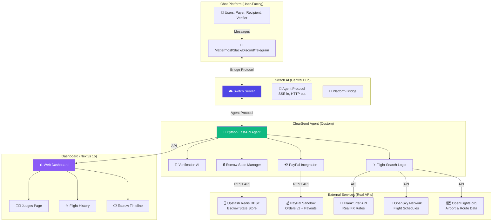

# ClearSend Room

**Real cross-border remittance + flight booking + escrow workflow powered by Switch AI**

[](LICENSE)
[](https://www.wemakedevs.org/hackathons/switch)
[](https://www.wemakedevs.org/hackathons/switch)

> **Flip the Switch Hackathon 2026**  
> Track: Best Business Workflow  
> Owner: Emmanuel Duke ([@dukemawex](https://github.com/dukemawex)), DUKERS LTD, Nigeria

## 🎯 What This Does

ClearSend Room connects an **AI coding agent** through **Switch AI** to a **team chat platform** (Slack, Discord, Telegram, or Mattermost) where the payer, recipient, and verifier collaborate on a real cross-border remittance workflow that includes:

1. **✈️ Flight Search & Booking**
   - Search REAL flights from OpenFlights.org and OpenSky Network data
   - Show transparent pricing with live FX rates (Frankfurter API)
   - Book with PayPal sandbox payments (Orders v2 API)
   - Collect traveler details and confirm before payment

2. **💰 Secure Escrow Management**
   - Create escrow transactions with 7 states: `created → funded → submitted → verified/rejected → released/refunded`
   - Store state in Upstash Redis REST with HMAC-signed role links
   - AI agent verifies deliverables against written specs
   - Human approval required for fund release (PayPal Payouts API)

3. **📊 Live Web Dashboard**
   - Next.js 15 app showing real-time escrow timelines
   - Flight booking history
   - PayPal activity tracking
   - Decision history and agent verification logs

**NO MOCK DATA. NO FAKE PRICES. HONEST FAILURES.**

## 🏗️ Architecture



### Switch's Central Role

**Switch AI is the orchestrator that makes this workflow possible:**

- **Connects agents to chat platforms**: Bridges the custom HTTP agent to Mattermost/Slack/Discord/Telegram
- **Manages rooms and context**: All users and agents share the same conversation, decisions, and documents
- **Routes messages**: Delivers user messages to the agent via SSE, returns agent responses to the chat
- **Handles addressing**: Users can @mention the agent or let it respond automatically based on room rules
- **Provides protocol abstraction**: The agent speaks a standard protocol (HTTP POST + SSE), Switch handles platform-specific APIs

**Without Switch, this workflow cannot function.** It's not just "nice to have"—Switch is the infrastructure that enables people and AI agents to collaborate as teammates in the same room.

## 🚀 Quick Start

### Prerequisites

1. **Switch Console** (includes Mattermost): [Download from Switch releases](https://github.com/sandbox-quantum/switch/releases)
2. **Python 3.11+** and **pip**
3. **Node.js 18+** and **npm**
4. **Free accounts**:
   - [Upstash Redis](https://console.upstash.com) (free tier)
   - [PayPal Developer Sandbox](https://developer.paypal.com/dashboard) (free)

### Installation

```bash
# 1. Clone the repository
git clone https://github.com/dukemawex/clearsend-room.git
cd clearsend-room

# 2. Set up environment variables
cp .env.example .env
# Edit .env with your credentials (see SETUP.md for detailed instructions)

# 3. Install agent dependencies
cd agent
pip install -r requirements.txt

# 4. Install dashboard dependencies
cd ../dashboard
npm install

# 5. Run the agent (in one terminal)
cd ../agent
python main.py
# Agent runs on http://localhost:3001

# 6. Run the dashboard (in another terminal)
cd dashboard
npm run dev
# Dashboard runs on http://localhost:3000

# 7. Open Switch Console
# - Import clearsend-room.template.yaml
# - Create the room
# - Start interacting in Mattermost or your connected chat platform
```

See **[SETUP.md](SETUP.md)** for detailed step-by-step instructions including:
- Creating PayPal sandbox credentials
- Setting up Upstash Redis
- Configuring Switch Console
- Connecting chat platforms
- Testing the workflow

## 💡 How to Use

### In the Switch Room (Chat)

**Search for flights:**
```
Search flights from Lagos (LOS) to London (LHR) on December 15 for 1 passenger
```

The agent will:
1. Search real flight data from OpenFlights/OpenSky
2. Show options with flight numbers, times, durations
3. Mark data as "Schedule only" if live pricing unavailable
4. Ask "Which flight would you like to book?"
5. Collect traveler details
6. Show complete price breakdown with FX rates
7. Ask for explicit confirmation
8. Only after you confirm: create PayPal order
9. Provide sandbox payment link

**Create an escrow:**
```
Create escrow for logo design worth 500 USD
```

The agent will:
1. Create escrow transaction
2. Provide payment link for payer
3. Track state: created → funded → submitted → verified → released
4. Wait for deliverable submission in the channel
5. Verify deliverable against spec
6. Post verification decision with reasoning
7. Wait for human approval
8. Only after approval: release funds via PayPal Payout

**Check status:**
```
Show my escrow transactions
```

### On the Dashboard (Web)

Visit `http://localhost:3000` to see:
- Real-time escrow transaction timeline
- Flight booking history
- PayPal payment activity
- Agent decision logs
- `/judges` page with full project documentation

## 🔒 Security Features

- **HMAC-signed escrow links**: Each role (payer, recipient, verifier) gets a cryptographically signed URL
- **Human-in-the-loop**: No money action (PayPal order, payout) happens without explicit human approval typed in the channel
- **Redis state encryption**: Escrow data stored with signatures, tamper-proof
- **Sandbox only**: All PayPal transactions use sandbox mode, no real money involved

## 🛠️ Technology Stack

| Component | Technology | Purpose |
|-----------|-----------|---------|
| **Orchestration** | Switch AI | Room management, agent-chat bridging, protocol handling |
| **Agent** | Python 3.11 + FastAPI | Custom HTTP agent implementing Switch protocol |
| **Dashboard** | Next.js 15 + React 19 + TypeScript | Real-time web interface |
| **Styling** | Tailwind CSS | Modern, responsive UI |
| **Payments** | PayPal REST SDK | Orders v2 API + Payouts API (sandbox) |
| **State Store** | Upstash Redis REST | Escrow transaction state with HMAC signing |
| **Flight Data** | OpenFlights.org | Airport and route database |
| **Flight Schedules** | OpenSky Network | Real flight tracking data |
| **FX Rates** | Frankfurter API | Real-time currency conversion (free, open-source) |
| **AI Model** | OpenRouter free tier or NVIDIA | nvidia/nemotron-3-ultra-550b-a55b:free |
| **Chat Platforms** | Mattermost (bundled), Slack, Discord, Telegram | User interface |

## 📦 Project Structure

```
clearsend-room/
├── agent/                          # Python FastAPI agent
│   ├── main.py                     # Agent server + Switch protocol
│   ├── requirements.txt            # Python dependencies
│   └── ...
├── dashboard/                      # Next.js 15 dashboard
│   ├── app/
│   │   ├── page.tsx               # Main dashboard
│   │   ├── judges/page.tsx        # Judges information page
│   │   ├── layout.tsx             # App layout
│   │   └── globals.css            # Global styles
│   ├── package.json
│   ├── tsconfig.json
│   └── ...
├── scripts/                        # Setup and utility scripts
│   ├── setup.sh                   # Automated setup
│   └── ...
├── docs/                           # Additional documentation
│   └── architecture.md            # Detailed architecture docs
├── clearsend-room.template.yaml   # Switch room template
├── .env.example                   # Environment variables template
├── .gitignore
├── LICENSE                        # MIT License
├── README.md                      # This file
└── SETUP.md                       # Detailed setup guide
```

## 🎬 Demo Video

**TODO**: Owner will record and upload demo video showing:
1. Creating a Switch room with the agent
2. Searching for real flights
3. Creating an escrow transaction
4. Verifying a deliverable
5. Releasing funds with human approval
6. Viewing the dashboard

Link will be added here before hackathon submission.

## 🧪 Testing

### Run Agent Tests
```bash
cd agent
pytest
```

### Build Dashboard
```bash
cd dashboard
npm run build
```

### Lint Code
```bash
# Python
cd agent
ruff check .

# TypeScript
cd dashboard
npm run lint
```

## 📚 Documentation

- **[SETUP.md](SETUP.md)**: Step-by-step setup instructions
- **[/judges](http://localhost:3000/judges)**: Full project documentation for judges (run dashboard to view)
- **[Switch Docs](https://docs.switchagents.ai/)**: Official Switch AI documentation
- **[Switch Agent Protocol](https://docs.switchagents.ai/switch-rooms/internals/agent-protocol)**: Technical protocol details

## 🤝 Libraries Used

- **FastAPI** (0.115.0): Web framework for the agent
- **httpx** (0.27.2): Async HTTP client
- **sse-starlette** (2.1.3): Server-Sent Events support
- **paypalrestsdk** (1.13.3): PayPal API integration
- **pydantic** (2.9.2): Data validation
- **Next.js** (15.0.3): React framework
- **React** (19.0.0): UI library
- **Tailwind CSS** (3.4.15): Styling
- **Recharts** (2.13.3): Dashboard charts

See `agent/requirements.txt` and `dashboard/package.json` for complete dependency lists.

## 📝 Environment Variables

Copy `.env.example` to `.env` and fill in:

```env
# Free AI Model (required)
MODEL_NAME=nvidia/nemotron-3-ultra-550b-a55b:free

# PayPal Sandbox (required)
PAYPAL_CLIENT_ID=your_paypal_sandbox_client_id
PAYPAL_CLIENT_SECRET=your_paypal_sandbox_secret

# Upstash Redis (required)
UPSTASH_REDIS_REST_URL=https://your-redis.upstash.io
UPSTASH_REDIS_REST_TOKEN=your_upstash_token

# Escrow Security (required - generate random)
ESCROW_LINK_SECRET=your_random_secret_32_chars

# Optional: RapidAPI for enhanced flight data
RAPIDAPI_KEY=your_rapidapi_key
```

See `.env.example` for all available variables.

## 🏆 Hackathon Requirements Met

✅ **Switch is central**: Connects agent to chat, manages rooms, handles protocol  
✅ **Real workflow**: Flight booking + escrow + verification with human oversight  
✅ **Real data only**: OpenFlights, OpenSky, PayPal, Upstash—no mocks or fakes  
✅ **Honest failures**: Clear error messages, transparent when data unavailable  
✅ **Free models**: OpenRouter free tier or NVIDIA (no paid API required)  
✅ **Web dashboard**: Next.js app showing live state, not just chat logs  
✅ **Human-in-the-loop**: All money actions require explicit approval  
✅ **README + architecture**: Mermaid diagram showing Switch's central role  
✅ **Setup instructions**: Step-by-step guide for judges to reproduce  
✅ **Judges page**: `/judges` endpoint with full project information  
✅ **MIT License**: Open-source license included  
✅ **.env.example**: No secrets in repo, clear configuration template  

## 🐛 Known Limitations

- Flight pricing may not be available for all routes (schedule data only)
- PayPal sandbox can have intermittent downtime (not our fault!)
- Redis free tier has connection limits (sufficient for demo)
- OpenSky API rate limits may apply
- Agent AI responses need improvement (free model limitations)

These are honest limitations, not hidden failures. The project handles them gracefully with clear user feedback.

## 🤔 Troubleshooting

**Agent won't start:**
- Check Python version: `python --version` (need 3.11+)
- Install dependencies: `pip install -r requirements.txt`
- Check `.env` file exists and has required variables

**Dashboard won't build:**
- Check Node version: `node --version` (need 18+)
- Clear cache: `rm -rf .next node_modules && npm install`
- Check port 3000 is available

**Switch Console errors:**
- Check Docker is running (Switch needs it for Mattermost)
- Check agent is running on port 3001
- Verify template YAML syntax is valid

**PayPal errors:**
- Confirm you're using SANDBOX credentials, not production
- Check client ID and secret are correct
- Visit PayPal developer dashboard to verify app status

See [SETUP.md](SETUP.md) for more troubleshooting steps.

## 🙏 Acknowledgments

- **Switch AI Team**: For building an amazing platform that makes agent-human collaboration possible
- **WeMakeDevs & DevTools Academy**: For organizing this hackathon
- **OpenFlights.org**: For comprehensive flight database
- **OpenSky Network**: For real-time flight data
- **Upstash**: For generous free Redis tier
- **PayPal**: For developer-friendly sandbox environment

## 📄 License

MIT License - see [LICENSE](LICENSE) file.

Copyright (c) 2026 Emmanuel Duke, DUKERS LTD

## 👨‍💻 Author

**Emmanuel Duke** ([@dukemawex](https://github.com/dukemawex))  
DUKERS LTD, Nigeria

Built for the Flip the Switch Hackathon 2026  
Track: Best Business Workflow

---

**⭐ If you find this project interesting, please star the repository!**

**🎬 Demo video coming soon**

**👨‍⚖️ [View full documentation for judges](/dashboard/app/judges/page.tsx)**
